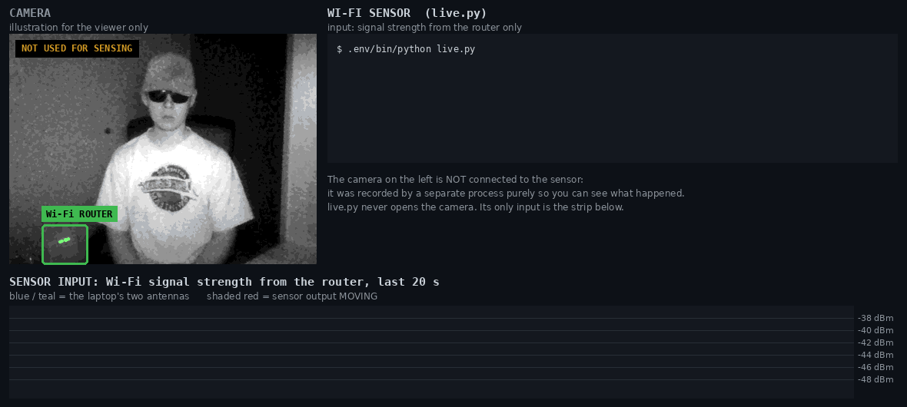

# Wi-Fi activity sensing (laptop ↔ router)



*Real recording, real time: sitting still, walking around, sitting back down.*
- **Left, the camera:** illustration only. A separate process recorded it so you can see what
  happened. `live.py` never opens the camera, and the camera plays no part in detection.
- **Right, `live.py`:** its only input is the laptop's Wi-Fi signal strength from the router, plotted
  at the bottom (both antennas). Red shading marks where the sensor reported MOVING.

Classifies the room as **empty**, **still** (someone present, not moving) or **moving**
from the Wi-Fi signal between this laptop and the router. No extra hardware.

Limits: the only input is two per-antenna signal strengths at 1 dB resolution, ~20×/s.
That is enough for coarse states, not for pose, location or breathing. The model is tied to
where the laptop and router sit. If you move either one, record and train again.

## Setup
```
conda create -y -p ./.env python=3.12
.env/bin/pip install -r requirements.txt
mkdir -p models && curl -L -o models/pose_landmarker_lite.task \
  https://storage.googleapis.com/mediapipe-models/pose_landmarker/pose_landmarker_lite/float16/latest/pose_landmarker_lite.task
```
Requires Linux with `iw` and `ping`. The pose model is only used by `collect.py` to check labels.

## Steps
1. `.env/bin/python collect.py`: about 21 minutes of guided activities (spoken prompts).
   The webcam only sanity-checks labels and no images are saved. Use `--no-camera` to skip it.
   Vary your spots between rounds.
2. `.env/bin/python train.py data/*.csv`: prints honest held-out accuracy and saves the model.
3. `.env/bin/python live.py`: live readings, with no camera:
   - **MOTION**: about 0.3–0.5 s delay and reliable (~98%). Expect about one false blip every 2 minutes.
   - **IN PATH**: whether someone, even sitting still, is in the laptop–router path.
     It averages ~2.5 s and is less reliable, because a still person off the path is invisible
     and the empty-room level drifts.
   - **last motion**: how long ago movement was last seen.
   - `--log file.csv` records the raw antenna signals and the readings.
   - Predicts 20×/s. For steadier, slower readings: `live.py --confirm 6 --path-lag 10`.
     The previous slow model (3 s/10 s windows) is kept: `live.py --model models/activity-steady-3s10s.joblib`.

More sessions (different days, times, positions) make it more robust. Train on all of them together.

`wifi_motion.py` is the original zero-training motion detector.
